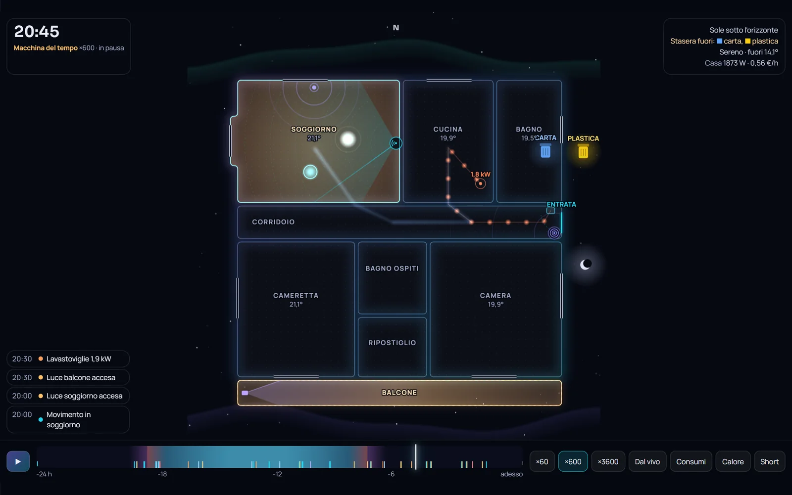
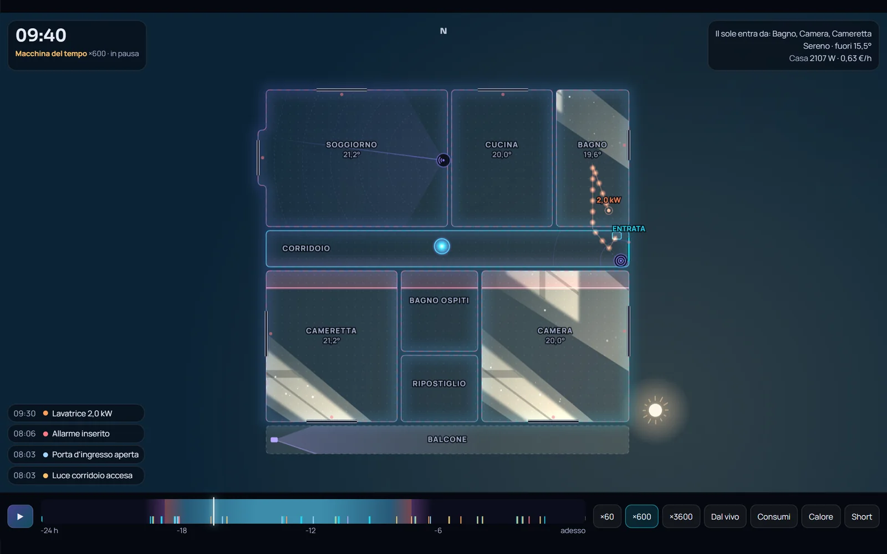
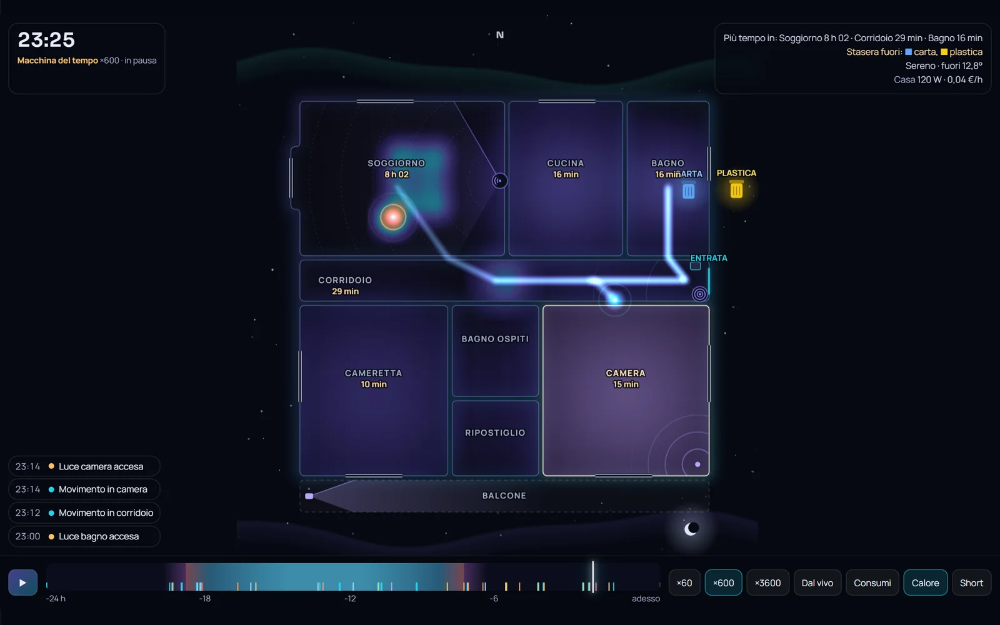
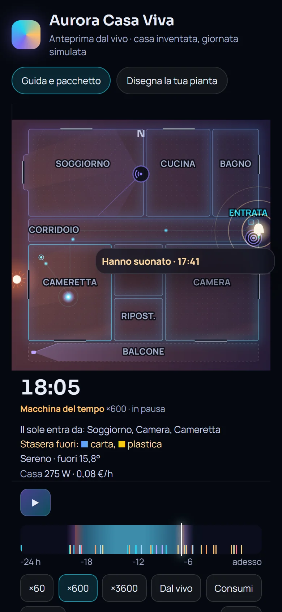

# Aurora Casa Viva — la pianta di casa animata per Home Assistant

🇬🇧 [Read in English](README.md)

Disegni la pianta di casa nel browser e Home Assistant la fa vivere: la luce del sole entra dalle finestre all'ora giusta, le stanze si accendono con le luci, una scia segue chi passa da una stanza all'altra e una barra fa rivivere le ultime 24 ore con lo storico vero.

- **Anteprima dal vivo (senza installare nulla):** https://domotikpro.it/aurora-casa-viva-demo/index.html
- **Editor "Disegna la tua pianta":** https://domotikpro.it/aurora-casa-viva-editor/index.html
- **Guida completa con schermate:** https://domotikpro.it/progetti/aurora-casa-viva

| Sole al mattino | Mappa di calore | Telefono |
|---|---|---|
|  |  |  |

## Cosa fa
- **Luce del sole vera:** azimut e altezza del sole dalla posizione di Home Assistant; i fasci passano dalle finestre, con davanzale, altezza e nuvole
- **Macchina del tempo:** le ultime 24 ore dallo storico, trascinando una barra o in replica accelerata
- **Scia di presenza** tra le stanze; con i radar LD2450 (es. Apollo MTR-1) le persone dove sono davvero e le zone del radar (piene quando c'è qualcuno dentro), con gli LD2410 (es. Apollo MSR-2) la distanza
- **Mappa di calore** e **mappa dei consumi** con kWh ed euro per stanza
- Energia che scorre dal quadro agli apparecchi, onde sonore, aria dalle finestre aperte, pioggia che si ferma sui muri, allarme, telecamere
- **Bidoni della differenziata** la sera e **spioncino/campanello** con l'ultima foto
- **Tocco** su una stanza per la luce, **pressione lunga** per i dettagli; i sensori che non rispondono vengono segnalati
- **Short verticale** 1080×1920 registrato con un pulsante
- Un solo file JavaScript, nessuna compilazione, HACS facoltativo, nessun cloud

## Installazione
La versione completa è in [`aurora-casa-viva/LEGGIMI.txt`](aurora-casa-viva/LEGGIMI.txt). In breve:

**Con HACS (copia la scheda e aggiunge la risorsa da solo):** HACS → ⋮ → *Repository personalizzati* → aggiungi `https://github.com/lucalux00/aurora-casa-viva`, tipo *Dashboard* → cerca **Aurora Casa Viva** → *Scarica* → ricarica il browser, poi fai i punti 1 e 4. Senza HACS segui tutti i punti.

1. **Disegna la pianta** con l'editor (online o [`aurora-casa-viva/editor/index.html`](aurora-casa-viva/editor/index.html), funziona anche senza internet) e copia il codice dalla scheda *Codice*.
2. **Copia la scheda:** metti `aurora-casa-viva/www/aurora-casa-viva` nella cartella `www` di Home Assistant.
3. **Aggiungi la risorsa:** Impostazioni → Plance → ⋮ → Risorse → `/local/aurora-casa-viva/aurora-casa-viva.js?v=1`, tipo *Modulo JavaScript*.
4. **Incolla la scheda:** plancia → matita → Aggiungi scheda → Manuale → incolla → Salva.

La scheda si chiama `custom:aurora-casa-viva`. Una casa completa di esempio è in [`aurora-casa-viva/scheda-esempio.yaml`](aurora-casa-viva/scheda-esempio.yaml).

## Privacy
Tutto avviene nella tua Home Assistant e nel tuo browser: nessun dato viene inviato. L'unica richiesta esterna sono i font Google (Manrope, Sora), che si tolgono con `fonts: false`. Anche l'editor lavora solo nel browser: l'immagine della pianta non viene caricata da nessuna parte.

## Licenza
Uso personale gratuito, nessuna ridistribuzione o modifica senza permesso: vedi [LICENSE](LICENSE). Puoi linkare liberamente il repository e la guida.

© 2026 [DomotikPro.it](https://domotikpro.it)
